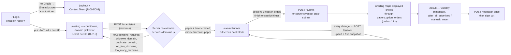
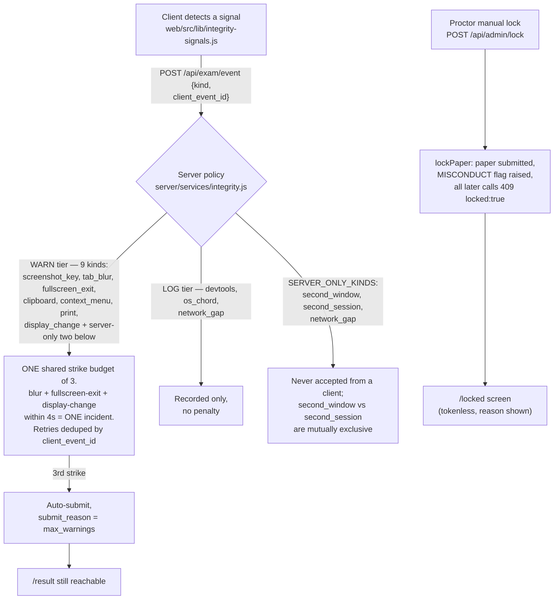
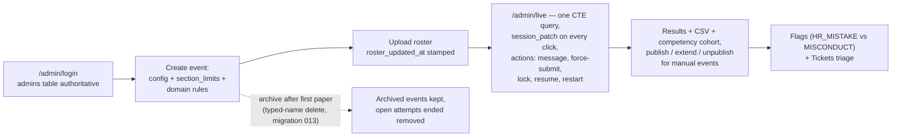
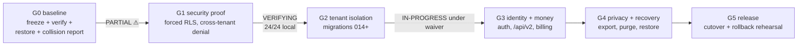
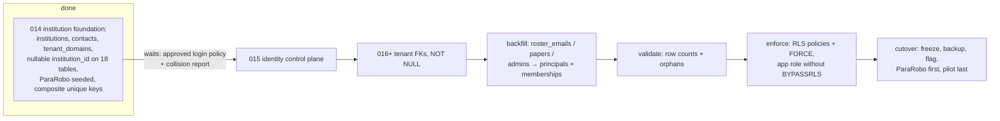

# ExamRobo — Decision Flow & Judgement Audit

One map of how the decisions flow through this project, whether the flows
follow the path that was provided, and where a judgement contradicts another
one. Built 2026-11-11 from a full read of the Brain files, `Idea.md`, the v1.5
code (`server/`, `web/`), the 40-file Phase-2 pack (`docs/Brain-Phase2-Production-Ready/`)
and the gate evidence.

Status legend used everywhere below:

| Mark | Meaning |
|---|---|
| ✓ | The decision, the docs and the code agree. |
| ⚠ | Drift: the decision is sound, but a doc or the code is behind it (fix listed in §5). |
| ✗ | Contradiction: two sources assert opposite things (finding F-xx in §5). |

---

## 0. Where the project stands today (2026-11-11)

- Branch `feat/saas-v2`. Release `v1.5.0` (`b5ddb76`), baseline tag
  `v1.5.0-baseline` (`3c6518b`). v1.5 is the shipped product and the rollback
  baseline; it is verified (161 unit / 187 smoke / clean web build).
- The working tree is dirty **on purpose**: migration
  `014_institution_foundation.sql`, the G1 harness (`scripts/g1.mjs`,
  `sql/g1-poc.sql`), `docs/phase2/GATE-REVIEW-PROTOCOL.md`,
  `docs/phase2/test-plans/` and `docs/phase2/evidence/g1/` are implemented but
  **not committed** (Brain/Log.md: "No commit or push").
- Gates: **G0 partial** (local verify green 4/4 at `1791455`; production-like
  restore + collision report blocked), **G1 VERIFYING** (24/24 local, no
  independent review), **G2 IN-PROGRESS** under the owner's scope-limited
  waiver (migration `014` done, `015` waits on the login policy + collision
  report), G3–G5 not started.
- `/api/v2` does not exist on the server yet; the 45-screen v2 UI is
  contract-only (renders `ContractPending`/`ApiErrorState` by design).

---

## 1. Master decision path

How the original idea travelled through pivots, phases and gates to today.
Every node is annotated with where the decision is recorded.

```mermaid
flowchart TD
    A["Idea.md — raw ask:<br/>Windows lockdown app, internet cut,<br/>auto-delete, intranet, 1000 seats,<br/>variants, flags, contact button"]
    A --> B["PIVOT (recorded in Idea.md itself<br/>+ Brain/PRD denied rules):<br/>Website first, any OS, one sitting"]
    B --> C["Phases 1-7 built:<br/>auth, bank + variants, runner,<br/>proctoring, results, admin, deploy"]
    C --> D["Live-exam defects batch<br/>(2026-10-21, Phase 9-10):<br/>integrity engine, clipboard /<br/>fullscreen / screenshot fixes"]
    D --> E["Phases 11-12:<br/>competency model + results<br/>analytics (R-013, R-014)"]
    E --> F["Phase 13:<br/>exact UI redesign (candidate path)"]
    F --> G["Phase 14:<br/>domain selection R-015 —<br/>registration dropped (Plan A)"]
    G --> H["Phases 15-17:<br/>SEB gate, per-question delivery,<br/>admin controls, results visibility"]
    H --> I["Phases 18-19:<br/>canonical v1.5.0 release<br/>VERIFIED — 161 unit / 187 smoke"]
    I --> J["2026-11-05/06:<br/>v2.0 multi-tenant SaaS approved.<br/>Register D-01..D-36<br/>+ 40-file pack"]
    J --> K["G0 baseline:<br/>tag v1.5.0-baseline,<br/>clean-tree verify 4/4"]
    K --> L{"G0 gate"}
    L -->|"production backup +<br/>collision report missing"| M["G0 PARTIAL ⚠<br/>local verify green, external data blocked"]
    M --> N["G1: isolated RLS proof<br/>24/24 PASS on PG16.15<br/>G1 VERIFYING — no independent review"]
    N --> O["Owner waiver 2026-11-08:<br/>G2 implementation allowed on<br/>scratch DBs only"]
    O --> P["Migration 014 implemented<br/>institutions + tenant columns<br/>UNCOMMITTED ⚠"]
    P --> Q["G2 NOT APPROVED.<br/>015 identity waits on approved<br/>login policy + collision report"]
    Q --> R["G3 identity + /api/v2 + billing<br/>then G4 privacy/ops<br/>then G5 cutover — not started"]
```

**Reading:** the path is coherent — every pivot is recorded at the moment it
happened, and the gate chain matches the owner directives. The ✗/⚠ items are
concentrated in *documentation sync*, not in the decision logic itself
(details in §5).

---

## 2. Runtime flows as actually coded (v1.5)

These diagrams describe the shipped v1.5 behaviour — `server/services/*` and
`web/src/*`, not the docs.

### 2.1 Student happy path

✓ This matches `Brain/Flow.md` happy path and PRD R-001..R-023, R-040, R-041.

### 2.2 Integrity escalation — the server decides

⚠ **Read this together with finding F-01:** the docs' "Tier A instant lock"
for `screenshot_key` is **not** what the code does — `screenshot_key` sits in
the WARN tier (`integrity.js:21,26`); it costs one strike and only the third
strike submits. Instant submission + lock happens only via a proctor's manual
lock or the 3rd strike.

### 2.3 Failure paths (as coded)

| Situation | Behaviour | Source |
|---|---|---|
| Crash / power loss mid-exam | Answers already on server (upsert per change); reopen before `ends_at` → resume at last question; past `ends_at` → auto-submit, no rejoin | Flow.md, R-021 ✓ |
| Connection loss | Local offline queue in `localStorage`, flushed on mount/online/submit; submission blocked while queue non-empty; `network_gap` logged server-side | T-1210, integrity.js ✓ |
| Roster removal mid-exam | Soft delete; active session kicked and submitted `removed`; re-adding restores access, never resurrects the paper | T-1304 ✓ |
| Second window / second device | `second_window` (tabs) vs `second_session` (sign-ins), mutually exclusive, server-detected only | T-953 ✓ |
| Locked exam | Terminal: 409 `locked:true` on every later call; `/locked` reachable without token | R-033 ✓ |
| Bank too small | `status: insufficient` from start, `{ status, category }` | TRD ✓ |

### 2.4 Admin flow

✓ Matches PRD Phase 5-6 and NextSteps Phases 16-17-19.

---

## 3. v2.0 governance flow

### 3.1 Gate chain

Rules the chain runs on (`docs/phase2/GATE-REVIEW-PROTOCOL.md`):
implement → freeze SHA → execute every `GX-TEST-CASES.md` case → independent
review → approve. **VERIFIED ≠ APPROVED.** Cross-tenant findings are
non-waivable NO-GO. The owner's two directives (2026-11-06 synthetic G1 POC;
2026-11-08 G2-on-scratch) are **waivers to proceed, not gate approvals** —
wording confusion recorded as F-03.

### 3.2 Migration path (expand → backfill → validate → enforce → cutover)

Current position: `014` implemented and scratch-verified, **uncommitted**;
`015` blocked on two owner inputs. The expand phase debt (write paths still
insert tenant rows without `institution_id` where seed/import already write
it) is tracked in `Brain/compact.md` → Open.

---

## 4. Decision validation

### 4.1 Idea.md asks → where they landed

| # | Idea.md ask | Decision taken | Landed in | Status |
|---|---|---|---|---|
| 1 | Windows-only lockdown app, internet cut | Website-first pivot (the pivot is in Idea.md itself); OS-level controls designed, not built; browser SEB gate shipped as interim | PRD R-034, `Brain/LockdownAgent.md`, T-959/T-1203/T-1204 | ✓ (agent design-only is explicit) |
| 2 | App auto-deletes after exam | Moot for a website | — | ⚠ not recorded as superseded → F-23 |
| 3 | Intranet-only network | Deferred by user; denied rule | PRD denied rules | ✓ |
| 4 | Sections with 3–4 variants per question | Built: variants per logical question | R-010, T-201..T-204 | ✓ |
| 5 | Different numbering/variants per student (anti-cheat) | Built: random variant + shuffled order per student, option-order mapping | R-011, migration 009 | ✓ |
| 6 | 1000 students at a time | v1: 1000-VU load target (script ready, **not run**); v2: plan ceiling 1000 students/event | R-060/T-702/T-814; D-16 | ⚠ dual meaning → F-05 |
| 7 | Data saved at every step | Built: per-change upsert + 15s snapshot + offline queue | R-021, T-1210 | ✓ |
| 8 | Flagged students: HR mistake vs misconduct | Built: disjoint taxonomy, resolvable | R-042, T-503 | ✓ |
| 9 | HR flagged if roster stale 2h before start | **Designed, not built** — rule needs a decision (fire once? re-fire?) | R-043, T-504/T-801 open | ⚠ tracked (Issue.md) |
| 10 | Contact-team button on failure | Built: ticket endpoint + auto-ticket on lockout | R-003, T-105 | ✓ |
| 11 | LinkedIn review share after exam | **Not built and not recorded anywhere** | — | ⚠ unrecorded ask → F-23 |
| 12 | Feedback form | Built (rating + comment, once per paper) | R-041, T-502 | ✓ |

### 4.2 Locked v2.0 decisions D-01..D-36 → evidence

| ID | Decision (short) | Evidence it landed | Status |
|---|---|---|---|
| D-01 | Forced RLS, no BYPASSRLS | `sql/g1-poc.sql`, `scripts/g1.mjs` 24/24; 014 expand phase | ✓ |
| D-02 | Elite subdomain only | pack 12/37; nothing built (pending G5) | ✓ |
| D-03 | Super Admin at admin.examrobo.com | pack 12/37 | ✓ |
| D-04 | One institution per staff principal | pack 14:45 SUPERSEDED marker | ⚠ pack 21 + web still carry membership/select → F-08 |
| D-05 | Exactly one Owner + one Admin | pack 26/29/33 | ✓ |
| D-06 | Employee rights, no delete | pack 01 permission matrix | ✓ |
| D-07 | Password + 24h temp password | pack 03 | ✗ pack 01 R-111/06/13/37 + web `/invite` page still say invite link → F-09 |
| D-08 | Super Admin password + WebAuthn, 2 accounts | pack 03/24 | ✓ |
| D-09 | Student email OTP / magic link, no self-registration | pack 06/13/29; Not.md | ✓ |
| D-10 | Unique individual student email | pack 01 R-103 corrected 2026-11-06 | ⚠ decision ✓, Brain verdict text stale → F-02 |
| D-11 | Invigilator PIN fallback, audited | pack 03/13 | ✓ |
| D-12 | Per-institution taxonomy | 014 `institution_id` on skills; taxonomy.sql writes legacy key | ✓ |
| D-13 | Per-institution bank, frozen copies | import-bank writes `institution_id`; `paper_questions` freeze | ✓ |
| D-14 | New `/api/v2`, `/api` stays compatible | web `endpoints.js` v2 map built; server router pending P20-06 | ✓ (planned gap, not drift) |
| D-15 | Billing in v2.0 | pack 05 reconciled | ✓ |
| D-16 | Plan table + platform ceiling | pack 02/05/29/33 aligned | ✓ (see F-05 for the 1000 wording) |
| D-17 | Admission warn 80% / block 100% | pack 13/29 | ✓ |
| D-18 | 15-min access + 7-day refresh | pack 03 | ✓ |
| D-19 | Plan expiry: no new attempts, 15-min recovery | pack 13 H5 / 29 | ✓ |
| D-20 | Closure: deactivate + retain | pack 08/36 | ✓ |
| D-21 | Purge manual, Super Admin, after archive | pack 08/36 | ✓ |
| D-22 | Admin results-only, Super Admin full archive | pack 08 | ✓ |
| D-23 | Institution controller, no DOB | pack 01/Not.md | ✓ |
| D-24 | Legacy institution `ParaRobo` | 014 seeds `ParaRobo` | ⚠ pack 09/30 say "ParaRobo Default" → F-13 |
| D-25 | Student transfer = new principal | pack 01/Not.md | ✓ |
| D-26 | Exam history deferred to v2.1 | Later.md | ✓ |
| D-27 | Hostinger + managed services | pack 12/15 open inputs | ✓ (open by design) |
| D-28 | Roster import: valid rows, ack before start | pack 13 H3 / 29 | ✓ |
| D-29 | Owner transfer Super Admin only | pack 29 | ✓ |
| D-30 | Staff invite = temp password, no link | pack 03 | ✗ same conflict as D-07 → F-09 |
| D-31 | Pending institution status-only | pack 06/29 | ✓ |
| D-32 | Platform sender + Reply-To | pack 15 | ✓ |
| D-33 | One audited billing service, reconciler sole writer | pack 05 | ✓ |
| D-34 | Billing rights Owner/Admin | pack 01/33 | ✓ |
| D-35 | SMS only for staff contact verification | pack 01/05/29; Later.md | ✓ |
| D-36 | Immutable plan snapshots, GST placeholder | pack 05 | ✓ |

**Score:** 31 fully ✓, 3 ⚠ (D-04, D-24, D-10-with-note), 2 ✗ (D-07,
D-30). The register itself is sound — the ✗ items are stale pack/UI
artifacts, not wrong decisions.

---

## 5. Contradiction & confusion register

Tie-breaker rule (from `Brain/ProjectReview.md` §2): where the pack
contradicts a locked decision, **the register wins until the pack is
amended**; where a Brain file contradicts reality, **reality wins and the
Brain file is corrected**. Each finding below says which side should move.

### A. Brain-internal

**F-01 ✗ — The integrity tier model in the docs does not match the code.**
- PRD R-030 (`Brain/PRD.md:135-146`), TRD tier table (`Brain/TRD.md:327-331`),
  Flow.md (`Brain/Flow.md:106-118`) and Design.md (`Brain/Design.md:165-167`)
  all describe **Tier A = instant lock** for `screenshot_key` ("exam submitted
  immediately, MISCONDUCT flag raised, signed out").
- The code has **two tiers only**: `TIERS = { WARN, LOG }`
  (`server/services/integrity.js:21`), with `screenshot_key` as the first WARN
  kind (`:26`). An instant submission+lock exists only via `lockPaper()`
  (`:164`, proctor action) or the 3rd strike. Phase 15 (T-1201,
  "warn-and-continue") made this change, and `Brain/Issue.md:180-186` states
  it correctly ("a **warning for review**, never as an automatic ending") —
  so the Brain contradicts *itself*.
- **Why it matters:** anyone implementing or reviewing from TRD/Flow will
  verify the wrong outcome; the smoke/unit tests pin the real behaviour.
- **Fix:** update R-030, the TRD integrity table, Flow.md "Integrity lockout"
  and the Design.md tier table to the two-tier model (WARN budget of 3 +
  incident dedup + server-only kinds), and state explicitly that
  `screenshot_key` is a strike, never an instant lock. One source of truth:
  `server/services/integrity.js`.

**F-02 ⚠ — ProjectReview §1 verdict paragraph is stale against itself.**
- `Brain/ProjectReview.md:27-31` says the pack "still contains proposed
  identity decisions… R-103 repeats a 'globally unique students.email' rule…
  ADR-IDENTITY-02 still asks whether global uniqueness is acceptable."
- But the pack was amended 2026-11-06: `01-PRODUCT-REQUIREMENTS.md:38-40`
  (R-103 corrected, no global-unique claim) and `14-ARCHITECTURE-DECISIONS.md:45`
  (ADR-IDENTITY-02 "SUPERSEDED by D-04"). ProjectReview's own Pack-resolutions
  table (`:119-125`) records exactly that correction.
- **Fix:** rewrite the §1 bullet: "the pack contained proposed identity
  decisions; they were corrected on 2026-11-06 and the register supersedes
  ADR-IDENTITY-02." Keep the corrected pack unedited otherwise.

**F-03 ⚠ — "G1 approved" vs "G1 VERIFYING" in the same file.**
- Header (`Brain/ProjectReview.md:6-8`): "the isolated G1 security proof… are
  approved as of 2026-11-06." Body (`:246-248`): the 11-06 authorization was a
  recorded **waiver for the POC only**; "G1 remains VERIFYING until
  independent review."
- **Fix:** change the header wording to "the G1 synthetic POC was authorized"
  — approval-to-run ≠ gate approval.

**F-04 ⚠ — Table-count drift after migration 014.**
- `Brain/Schema.md:7` and `Brain/Start.md:14` still say "18 domain tables +
  schema_migrations". `server/sql/schema.sql` now has **22** CREATE TABLEs
  (18 v1.5 + `institutions` + `institution_contacts` + `tenant_domains`).
- **Fix:** "18 v1.5 domain tables + 3 tenant-foundation tables (migration 014)
  + ledger."

**F-05 ⚠ — "1000" means two different things.**
- D-16 / pack 02: **1000 students per event** (plan ceiling).
- `Brain/compact.md:45` ("1000 concurrent target — P7 load test") and pack 10
  (`10-COMPATIBILITY-PERFORMANCE.md:61,65`): **1000 concurrent students**
  as a *candidate workload*, explicitly "not a verified capacity statement".
- **Fix:** always write "1000 roster/event (ceiling)" vs "1000 concurrent VUs
  (load-test candidate)".

**F-06 ⚠ — NextSteps P20-04 status cell carries a paragraph.**
- `Brain/NextSteps.md:312` embeds a long narrative inside the Status column;
  every other row uses the short status vocabulary.
- **Fix:** `[>] VERIFYING — 24/24 local; independent review pending`.

**F-07 ⚠ — T-1201 wording invites a misread.**
- `Brain/NextSteps.md:209` "warnings never submit" vs the 3rd-strike
  auto-submit everywhere else. The intent is "no single warning submits by
  itself; the third strike does".
- **Fix:** one clarifying clause in T-1201.

### B. Brain ↔ Pack

**F-08 ✗ — `POST /auth/membership/select` contradicts locked D-04.**
- Pack `21-API-CATALOG-AND-CONTRACTS.md:21` still defines membership
  selection; `14:45` supersedes it, `03:66` says a second membership "fails
  closed", and `29` AUTH-003 expects a second membership to be **rejected**.
  The **web was built against the stale catalog**:
  `web/src/lib/endpoints.js:24` (`membershipSelect`).
- **Fix:** delete the endpoint row from pack 21 (record the removal in its
  revision note) and drop `membershipSelect` from `endpoints.js`.

**F-09 ✗ — Invite-link credential setup contradicts locked D-07/D-30.**
- Pack `01` R-111 ("Credential setup uses a one-time invite; never email a
  password"), doc `06` §3, doc `13` and doc `37` P-05 (`/invite/:token` for
  invited staff) all describe an invite link. D-07/D-30 lock "Admin sets a 24h
  temporary password (no invite link)". The web page
  `web/src/pages/public/InviteSetup.jsx` implements the stale variant.
- **Fix:** amend pack 01/06/13/37 to the temp-password flow (or, if the
  owner prefers invites, amend D-07/D-30 — one or the other, decided once);
  mark `/invite/:token` contract-pending until P20-06.

**F-10 ⚠ — Two unreconciled API catalogs inside the pack.**
- Doc `06` proposes `/api/auth/identify` + `/api/public/registrations*` +
  `/api/sa/*`; doc `21` proposes `/auth/login` + `/public/institution-applications*`
  + `/platform/*`. Both hedge "must be reconciled"; nothing reconciles them.
  The web follows **21**.
- **Fix:** declare 21 the single catalog in `00-FILE-MANIFEST.md`; either fold
  06 into 21 or stamp 06 "superseded by 21".

**F-11 ⚠ — Three different required DB-role inventories.**
- Doc `03:84-96` lists 9 roles incl. `examrobo_billing_fn`; doc `24:26-35`
  lists 8 (no billing_fn); the executed G1 harness (`server/scripts/g1.mjs`)
  creates 9 but **without** `examrobo_billing_fn` (with `examrobo_platform_app`).
- **Fix:** one canonical role table (doc 03); add `examrobo_billing_fn` to the
  harness or record that it is deferred to G3 with a test-plan note.

**F-12 ⚠ — `student_auth_links` exists only in doc 22.**
- `22-DATABASE-OWNERSHIP-TENANT-MATRIX.md:50` introduces `student_auth_links`;
  doc `04`'s registry instead carries a nullable `students.principal_id`. Two
  competing mechanisms for the same problem.
- **Fix:** pick one (the 22 link-table is the cleaner separation), mirror it
  in 04 and the registry, and add the CI assertion.

**F-13 ⚠ — Legacy tenant named three ways.**
- D-24 / 014 / Log.md: **`ParaRobo`**. Doc `09:32` and `30:33`: "**ParaRobo
  Default**" (30 adds "must not be a silent sink").
- **Fix:** use `ParaRobo` everywhere; keep the "not a silent sink" rule as a
  sentence, not a different name.

**F-14 ⚠ — Pack file count is quoted as 38; the folder holds 40.**
- `Brain/ProjectReview.md:12` and `userRequirement.md:16` say "38-file pack";
  `docs/Brain-Phase2-Production-Ready/` contains **40** markdown files (two
  `00-` files plus README).
- **Fix:** correct the count, or renumber the two 00- files.

**F-15 ⚠ — Module list drift: 9 vs 17.**
- Doc `02` §5 lists 9 modules; doc `20` §2 lists 17 (adds students, staff,
  plans, registration, question-bank, notifications, platform). The pack's own
  rule says conflicts must be resolved, not guessed.
- **Fix:** make 20 authoritative; 02 keeps the nine core subsystems with a
  pointer to 20.

**F-16 ⚠ — R-043 (HR auto-flag) and recording retention never carried into v2.**
- The v1.5 items are still open (`Brain/Issue.md:399-406`), but doc `07` §8's
  eleven required job types contain neither; R-131 compatibility never lists
  R-043 either.
- **Fix:** add a decision row — carry R-043 into the v2 job list or reject it
  explicitly in `Not.md`; same for a recording-retention job (legacy data
  only).

**F-17 ⚠ — Two task-ID schemes with no cross-map.**
- Doc `27` uses S0-01..S2-10; docs `16`/`35` use P2-xxxx; doc `32` accepts
  either but nothing maps S1-09 ↔ P2-0105/0106.
- **Fix:** add an S↔P2 column to 27, or regenerate 27 with P2 IDs.

**F-18 ⚠ — Doc 35's sample tracker is stale.**
- `35-EXECUTION-TRACKER-TEMPLATE.md:39-40` shows DQ-01/DQ-02 "OPEN" although
  docs 15/33/36 record them partially closed on 2026-11-06.
- **Fix:** refresh the sample rows so the template starts from today's truth.

**F-19 ⚠ — Doc 36 contradicts its own revision history.**
- The revision table (`36:229`) says v1.0 left DEC-04/05/06 open while the
  v1.1 approval summary records DEC-04 APPROVED / DEC-05 conditional /
  DEC-06 mandatory-corrected. Acknowledged in-text but contradictory on its
  face.
- **Fix:** annotate the v1.0 row "superseded by v1.1 corrections" so a reader
  never quotes v1.0 states.

### C. Brain ↔ Code

**F-20 ⚠ — Web leftovers referencing removed recordings.**
- `web/src/pages/admin/Events.jsx:312,401` archive copy says "papers, results,
  warnings and **recordings** are kept"; `web/src/pages/admin/Live.jsx:19,36`
  keeps a `recording_revoked` label. Cosmetic (no logic), but it re-normalizes
  a feature the product removed.
- **Fix:** drop "recordings" from the copy; keep the historical label only if
  you want old events to render their historical kind — otherwise remove it.

**F-21 ⚠ — Stale comment in the migration runner.**
- `server/scripts/migrate.js:28-33` carries a hardcoded comment listing only
  migrations 001–006; application is a dynamic sorted directory read and
  Log.md already corrected the runner fact ("applies unledgered files once,
  records checksums").
- **Fix:** delete or refresh the comment.

### D. Idea-level asks never recorded

**F-22 ⚠ — LinkedIn post-exam review share.**
- Asked in `Idea.md:19`; not built; **not recorded** in `Not.md`/`Later.md`,
  so no future agent knows it was consciously skipped (R-041 covers the
  feedback form only).
- **Fix:** one line in `Later.md`: "Post-exam social share (LinkedIn) — later;
  v1 ships the feedback form instead."

**F-23 ⚠ — "App auto-deletes after the exam".**
- Moot after the website pivot, but never recorded as superseded.
- **Fix:** one line in `Not.md`: "Auto-delete of an exam app — superseded by
  the website-first decision; nothing to delete."

---

## 6. Open decisions that still need you (the user)

1. **Login policy sign-off** — unblocks migration `015`: student email OTP vs
   magic link wording, and the D-07/D-30 vs pack-invite conflict (F-09) — pick
   temp-password or invite link, once.
2. **Legacy collision report** — needs the live DB; unblocks G0 closure and
   the 015 backfill.
3. **G1 independent review** — the proof passes 24/24 locally; it stays
   VERIFYING until a reviewer signs.
4. **HR auto-flag rule (R-043)** — fire once per event? re-fire per roster
   upload? per-email or per-event? (also decides F-16).
5. **SEB real config** (T-1205/T-1207) — stable hostname + SEB Config Tool
   output + Windows acceptance.
6. **Load runs** — 50-VU (T-1518) and 1000-VU (T-702/T-814) k6 executions.
7. **Browser click-throughs** — T-1521, T-1039/T-1109, P20-UI-09 (needs a
   human at 320/390/tablet/1280).
8. **External inputs** (tracked in `Issue.md`/`NextSteps.md`) — hosting
   region, SMTP + SPF/DKIM/DMARC, SMS/DLT, Razorpay KYC, CA/GST approval, DPA
   + minors attestation, RPO/RTO, Elite DNS/wildcard TLS.
9. **Commit the G1/G2 checkpoint** — `014` + gate artifacts are verified but
   uncommitted; say when to commit.
