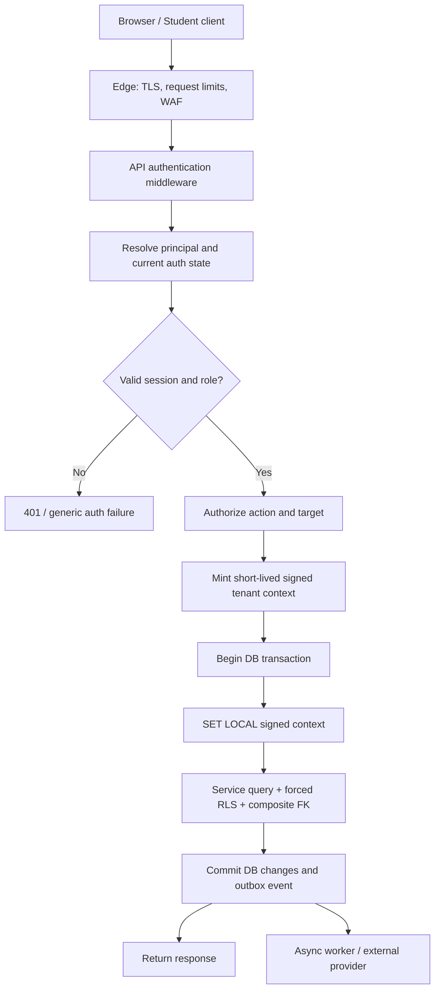

# System Architecture — Phase 2 SaaS

## 1. Architecture decision

Use a shared application deployment and shared PostgreSQL database with logical tenant boundaries. Tenant ownership is enforced by application authorization, signed database tenant context, forced RLS, composite foreign keys and tenant-scoped data access. Redis, object storage, WebSocket rooms, exports and background workers must carry the same tenant identity and authorization context.

## 2. Logical components

| Component | Responsibility | Trust level |
|---|---|---|
| Public web/API | Login, registration, applicant status | Untrusted client input |
| Authentication service | Identity lookup, credential verification, session issue/revoke | Trusted application service; dedicated auth DB role/pool |
| Tenant API | Institution-scoped business operations | Authenticated and authorized |
| Platform API | Super Admin workflows and aggregate reporting | Highly privileged; explicit action scope and audit |
| PostgreSQL app role | Tenant reads/writes under RLS | No ownership; no BYPASSRLS; cannot execute pre-auth lookup functions |
| PostgreSQL auth role | Execute narrow identity/session functions | Dedicated pool; no tenant business-table access |
| Auth lookup function role | Read restricted auth directory only | No tenant base-table access |
| Context verifier function role | Verify signed tenant context | Read private signing-key material only |
| Billing function/module | Subscription/invoice/payment mutations | Tenant-scoped and institution-locked |
| Worker process | Claims jobs, executes idempotent handlers | No tenant-wide RLS bypass |
| Notification provider adapter | Email/SMS delivery | External dependency; isolated secrets |
| Payment adapter | Razorpay order/refund/status calls | External dependency; server-side secrets |
| Redis | Cache, revocation notifications, transient coordination | Never source of truth |
| Object storage | Logos, PDFs and approved files | Tenant-scoped paths and signed access |
| Recovery ledger | Privacy tombstones and recovery intent | Separate failure/security domain |

## 3. Request path

No application operation may derive a tenant from a client-supplied `institution_id`. The tenant comes from the authenticated membership or from a separately authorized, audited platform operation.

## 4. Trust boundaries

1. Browser input is untrusted, including hidden fields, route parameters, WebSocket messages and uploaded filenames.
2. JWT claims identify a candidate principal and session; they do not alone grant current access.
3. The application must authorize role, membership, institution state, feature and target ownership before performing a mutation.
4. The database RLS context is verified by a DB function; a plain session GUC is not trusted.
5. The runtime application role cannot own tenant tables, bypass RLS, read private keys or execute migrations.
6. The worker can claim system jobs but must obtain a tenant-scoped context before touching tenant business rows.
7. External providers are not transactional participants. Their state is reconciled through durable inbox/outbox records.
8. A database superuser/host administrator remains outside the RLS threat boundary and is controlled through infrastructure IAM, break-glass approval, audit and key management.

## 5. Application modules

Use explicit modules with narrow responsibilities:

- `auth/`: principal resolution, credentials, sessions, revocation and WebSocket tickets.
- `tenancy/`: signed context creation, `runAsTenant`, tenant authorization and tenant ID mapping.
- `institutions/`: registration, review state, admin state, contacts and onboarding.
- `subscriptions/`: period creation, limit snapshots and entitlement reconciliation.
- `billing/`: orders, invoices, webhook inbox, payment reconciliation and refunds.
- `jobs/`: job claiming, leases, retries, dead letters and job run history.
- `privacy/`: requests, data export, anonymisation, tombstones and restore barrier.
- `audit/`: append-only tenant and platform audit events.
- `exams/`: existing v1.5.0 exam domain, modified only for tenant context and scoped relationships.

Do not let each route implement its own tenant filtering or lifecycle rules.

## 5a. Tenant propagation outside PostgreSQL

- **Redis:** prefix every tenant-owned cache, lock, rate bucket, queue channel and WebSocket room with the server-derived institution ID, e.g. `tenant:{iid}:event:{eventId}`. Verify ownership before constructing the key; never accept a raw prefix from the client. Global keys are explicitly allow-listed and contain no tenant payload.
- **WebSockets:** redeem a one-use ticket bound to subject, tenant, role, session version and auth epoch. Verify tenant ownership before joining a room. Every fan-out message carries tenant ID and is filtered on every application instance. A shared Redis pub/sub channel must not imply shared room visibility.
- **Object storage:** use tenant-prefixed opaque keys such as `tenants/{iid}/exports/{exportId}`; validate metadata/ownership before issuing a short-lived signed URL. A file ID alone is not authorization. Use private buckets, encryption, content-type/size validation, malware scanning where appropriate, and lifecycle cleanup.
- **Exports:** generate in a tenant-scoped background job with keyset pagination and bounded memory. Store the export record with tenant ownership, expire the artifact, and re-authorize the download. Do not keep a tenant DB transaction open while streaming to the browser.
- **CDN/cache:** never use a cache key that omits tenant identity for tenant-specific data; disable shared/public caching for authenticated exports/results.
- **Logs/traces:** attach tenant correlation only where needed; do not log raw student answers, credentials, OTPs or unnecessary PII. Access to tenant identifiers in telemetry is restricted.

## 6. Database transaction contract

- `q()` is the only tenant-aware query entry point for request code. It requires an active request transaction with a valid signed context.
- `withTransaction()` uses a savepoint when nested in the existing request transaction; it does not silently open a second transaction for the same operation.
- `runAsTenant(iid, actor, reason)` is available only to approved system/platform workflows. It mints a tenant-scoped context after authorization and audit, then opens a tenant transaction.
- `systemQuery()` is limited to system/queue tables and approved functions. It does not query tenant business tables through RLS bypass.
- `withoutTx()` is used only for network calls or long file I/O. The caller must persist an intent/outbox record before leaving the transaction and reconcile the result afterward.
- Request transactions must have strict maximum duration. Do not hold one open across Razorpay, SMTP, SMS, image processing, PDF rendering or browser streaming.
- All connections use transaction pooling only if the signed context is set with `SET LOCAL` inside every transaction and no session-level state is relied upon.

## 7. Super Admin access

Super Admin is a platform role, not a magic tenant wildcard.

- Platform dashboards use a minimized `platform_tenant_aggregate` projection and dedicated functions; they do not directly scan tenant student/exam tables.
- A support action targeting one institution must specify target institution, actor, reason, permission and expiry; the system records a `platform_action`/`support_access_grant` before access. The context verifier validates that grant on every use.
- The function then creates a tenant-scoped context for that one institution. Access is time-limited and read-only by default.
- Student answers, proctor telemetry and identity exports require separately granted purpose and are not part of the default global dashboard.
- There is no policy such as `tenant_id = current_iid() OR current_role() = 'super_admin'`.

## 8. Failure behavior

| Failure | Required response |
|---|---|
| Auth directory unavailable | Fail closed; do not issue token |
| Context signature invalid/expired | No tenant rows; authorization failure |
| RLS helper unavailable | Transaction fails closed |
| Redis unavailable | Auth must use authoritative DB state; do not trust stale revocation cache |
| Payment provider unavailable | Preserve pending state; queue reconciliation; no activation |
| Email/SMS provider unavailable | Outbox remains pending and retries; do not roll back business transaction |
| Worker unavailable | Queue depth/age alerts; jobs resume after worker recovers |
| Privacy ledger unavailable | Do not acknowledge request as accepted; retain a retryable request at intake without claiming completion |
| Restore verification incomplete | Keep application ingress disabled |

## 9. Architecture acceptance

The architecture is accepted only after the tests in `11-TEST-STRATEGY.md` pass against the actual PostgreSQL major version and application source. A diagram or mock database does not satisfy this gate.
