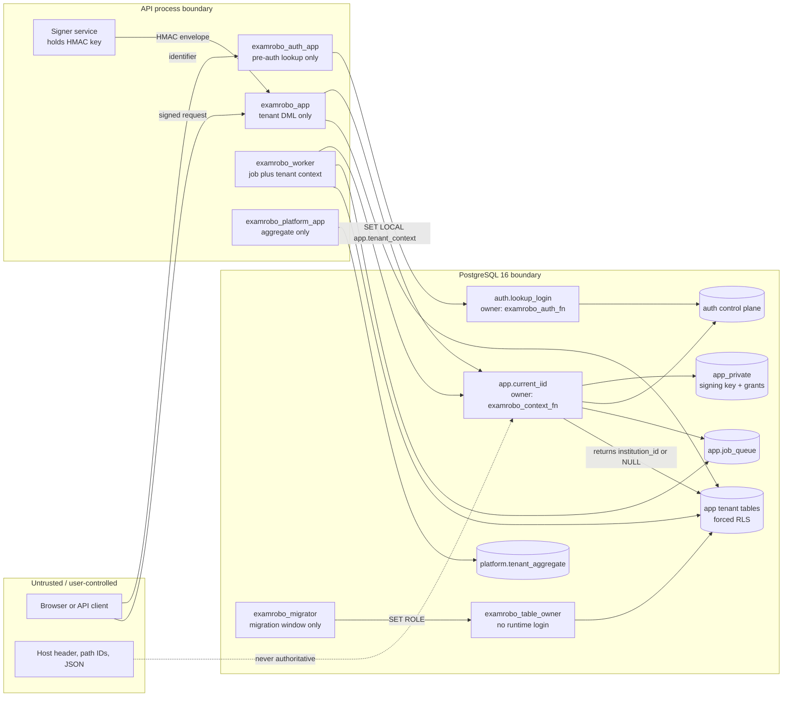

# G1 threat model and trust boundaries

- Date: 2026-11-08
- Scope: isolated, synthetic G1 security POC
- Status: reviewer input; not an approval
- Proof schema: `server/sql/g1-poc.sql`
- Harness: `server/scripts/g1.mjs`
- Raw output: `test-output.txt`, `results.json`, `role-report.json`

This document describes the threats the G1 proof is meant to stop and the
boundaries it does **not** cover. It is intentionally narrower than the full
v2.0 threat model because G1 proves the database authorization boundary before
tenant product code exists.

## 1. Assets

- Tenant business rows: institutions, students, events/parents, papers/children,
  invoices.
- Authentication control plane: principals, login identifiers, memberships,
  service principals, institution auth state.
- Tenant signing key and support-grant metadata in `app_private`.
- Worker job/lease metadata.
- Platform aggregate projections.
- Audit and migration authority.

## 2. Trust boundaries

The important boundary is not the HTTP edge. It is the database function that
turns a signed, transaction-local envelope into an institution UUID. A caller
that can set arbitrary GUCs still cannot produce a valid envelope.

## 3. Adversaries and required outcomes

| # | Adversary / mistake | Boundary crossed | Required outcome | Proof |
|---|---|---|---|---|
| T1 | Authenticated tenant A guesses tenant B UUID | app role -> tenant table | 0 rows / no mutation | SEC-001, SEC-002 |
| T2 | Tenant A writes a row with tenant B institution ID | app role -> tenant table | RLS rejects the write | SEC-003 |
| T3 | Compromised query sets `app.iid = B` | app role -> RLS context | context verifier returns NULL | SEC-004 |
| T4 | Attacker forges, truncates, tampers, expires or re-signs a context | API -> verifier | no access | SEC-005 |
| T5 | Disabled staff principal reuses a context | API -> verifier | no access | SEC-006 |
| T6 | Institution auth epoch changes while a context is live | API -> verifier | no access | SEC-007 |
| T7 | App role tries pre-auth lookup | app role -> auth control plane | permission denied | SEC-008 |
| T8 | Auth role tries to read tenant or auth tables directly | auth role -> tenant/auth | permission denied | SEC-009 |
| T9 | App role tries to read or replace the HMAC key | app role -> private key | permission denied | SEC-010 |
| T10 | Platform dashboard asks for raw tenant rows | platform app -> tenant table | no rows; aggregate only | SEC-011 |
| T11 | Support grant is used against another institution | support context -> tenant | no rows / wrong grant denied | SEC-012 |
| T12 | A pooled connection retains tenant context after commit, rollback or error | pool reuse | no inherited tenant | SEC-013 |
| T13 | Stale worker lease mutates tenant data | worker -> tenant | no mutation | SEC-014 |
| T14 | A foreign tenant parent is inserted under a valid tenant | composite FK | foreign key rejects | SEC-015 |
| T15 | A new tenant table is added without classification | registry / CI | checker reports it | SEC-016 |

## 4. Abuse cases intentionally out of scope for G1

G1 is a database authorization proof. These are **not** claimed as proven:

- Full compromise of the API host or the database superuser plane.
- A malicious migration owner or a leaked migration credential.
- Host-header or subdomain routing as tenant authorization.
- HTTP route authorization, IDOR at the route layer, rate limits or CSRF.
- Redis cache/lock key isolation and WebSocket room isolation.
- Object-storage paths, signed URLs, exports, CSV formula injection and file
  traversal.
- Email/SMS/OTP delivery, provider webhooks, replay and signature verification.
- Billing, entitlement and plan-limit enforcement.
- Timing, traffic analysis or row-existence side channels that do not return
  tenant data but may leak metadata.
- Backup, restore, PITR and erasure replay.
- Legal/privacy retention, DPA and minors consent.

These remain G2-G5 work and must not be represented as covered by this POC.

## 5. Assumptions

- The application signs a canonical context and sets it only with
  `SET LOCAL app.tenant_context` inside a transaction.
- The signing key is generated outside the database, is not logged, and is
  available only to the signer and the context-verifier function.
- The context verifier owns the private key/support-grant/auth-state reads and
  has no tenant business-table privileges.
- `examrobo_app` and `examrobo_worker` are not table owners, superusers or
  `BYPASSRLS`.
- The context lifetime is short (60 seconds in the POC) and the verifier
  rechecks principal, membership, institution state, session version and auth
  epoch.
- Every tenant table is classified in the registry and has forced RLS.
- PostgreSQL 16.15 was used for this proof.

## 6. Residual risks and reviewer questions

1. **Custom HMAC-in-Postgres.** The verifier is security-sensitive custom code.
   Review canonical encoding, duplicate/unknown field rejection, constant-time
   comparison, key rotation overlap, clock skew, length limits and the
   `EXCEPTION WHEN others THEN RETURN NULL` fail-closed behavior.
2. **Function ownership.** A future migration must not accidentally give
   `examrobo_context_fn` tenant-table access or make `examrobo_app` the owner of
   a verifier function.
3. **Context trust upstream.** G1 proves the database rejects a bad context; it
   does not prove the API mints one correctly. Route-level authorization and
   signer implementation need separate review.
4. **Lease semantics.** The worker proof uses one synthetic lease token. The
   real worker must bind job ID, job type, lease token and tenant together and
   reject expired leases on every tenant mutation.
5. **Support access.** The POC proves a scoped read grant. Real support access
   also needs institution approval or approved break-glass, step-up auth,
   dual control where required, and append-only audit.
6. **Platform aggregate.** The aggregate function returns a stored projection.
   The real platform dashboard must not gain a raw-table fallback.
7. **Pooled connections.** The POC proves transaction-local reset on a single
   pool. The real deployment must not use session-level `SET`, and any future
   pooler must preserve transaction-local semantics.
8. **Image pinning.** The proof used PostgreSQL 16.15. The `postgres:16-alpine`
   index digest resolved on 2026-11-08 is
   `sha256:aa6cb33cf4c19c765cefcf48d96176258800870a9a1e930ad126200f9d825139`
   (`linux/amd64` manifest `sha256:ac838714b7d794185a866e5a6b479b954e7d8a070568aa0acac6fe07c3070bf5`).
   The local `RepoDigest` must still be confirmed and pinned before production.

## 7. Reviewer disposition

G1 is **not approved** by this document. The independent reviewer must record:

- reviewer identity and date;
- environment and PostgreSQL image digest used for the rerun;
- pass/fail against ROLE-01..08 and SEC-001..016;
- any Critical/High finding;
- whether the custom HMAC boundary is accepted, replaced or conditional;
- explicit approval, rejection or time-bound conditional approval.

Until that disposition exists, G2 and all production tenant work remain blocked.
